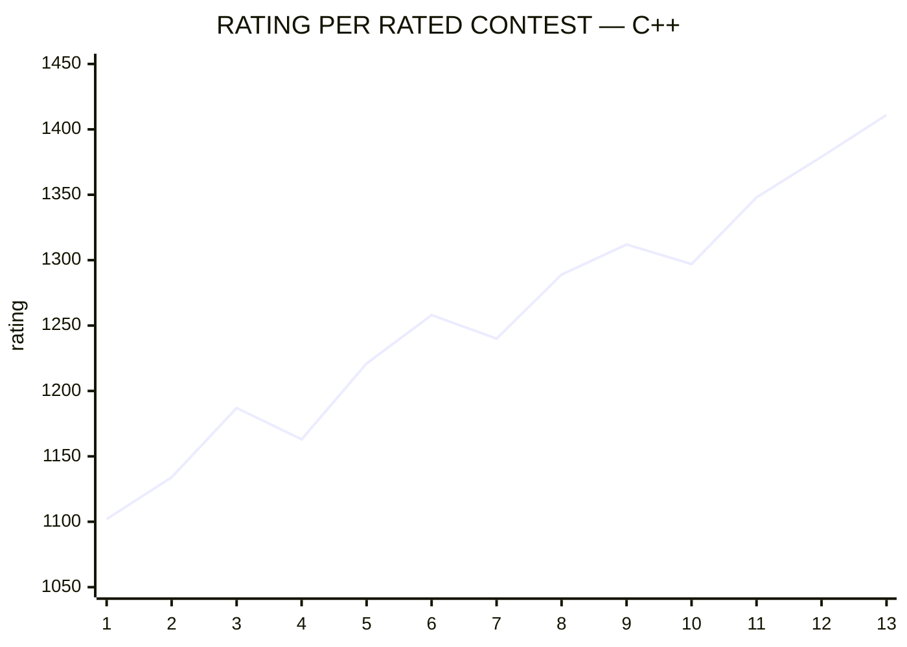
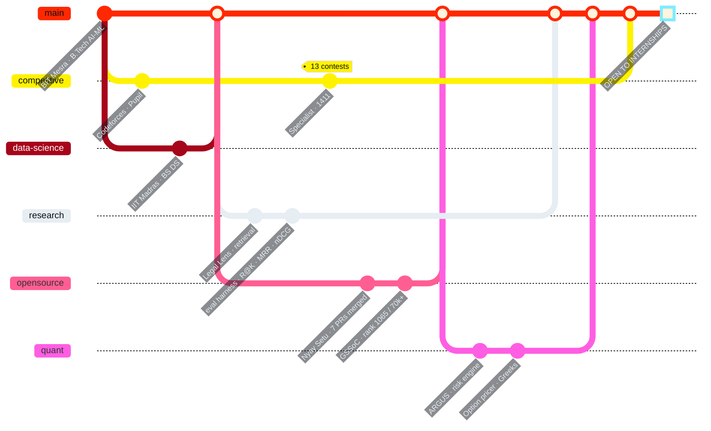

<picture>
  <source media="(prefers-color-scheme: dark)" srcset="https://capsule-render.vercel.app/api?type=venom&height=250&color=0:FF2800,60:A6051A,100:FFF200&text=OMJEE%20R%20GIRI&fontSize=56&fontColor=FFFFFF&fontAlignY=36&desc=AI%20%2F%20ML%20ENGINEER%20%E2%80%A2%20DATA%20SCIENCE%20%E2%80%A2%20SYSTEMS%20BUILDER&descAlignY=55&descSize=16&animation=fadeIn">
  
</picture>

<div align="center">


<br>

<a href="#-driver"></a>
<a href="#-timing-tower"></a>
<a href="#-sector-splits"></a>
<a href="#-telemetry"></a>
<a href="#-race-history"></a>

<br><br>


</div>


## 🏎 driver

```console
omjee@scuderia:~$ ./driver --card
╔══════════════════════════════════════════════════════════════════╗
║                                                                  ║
║   D R I V E R      Omjee R Giri                                  ║
║                                                                  ║
║   ACADEMY          B.Tech · Artificial Intelligence & ML         ║
║                    Birla Institute of Technology, Mesra          ║
║                                                                  ║
║                    BS · Data Science and Applications            ║
║                    Indian Institute of Technology, Madras        ║
║                                              [ run concurrently ]║
╚══════════════════════════════════════════════════════════════════╝

omjee@scuderia:~$ ./circuit --loop
        ╭────────────── UNDERSTAND ──────────────╮
        │                                        ▼
     OPTIMIZE                                  BUILD
        ▲                                        │
        ╰──── ITERATE ◀───── MEASURE ◀───────────╯

   S1  data arrives clean ................................. [ GREEN ]
   S2  retrieval is measurable ............................ [ GREEN ]
   S3  the API answers when a provider goes down .......... [ GREEN ]
   ──  "if it isn't measured, it's a guess"
```

> **I don't want to only build models. I want to understand the system around them.**


## 🏁 timing tower

```console
┌─────┬─────┬────────────────────┬───────────────────┬───────────┬──────────┐
│ POS │ No. │ PROGRAMME          │ SECTOR            │ STATUS    │ INTERVAL │
├─────┼─────┼────────────────────┼───────────────────┼───────────┼──────────┤
│ P1  │ 01  │ LEGAL LENS         │ AI / RETRIEVAL    │ ▰ RUNNING │    —     │
│ P2  │ 02  │ qEEG SUBTYPING     │ RESEARCH / SIGNAL │ ▱ IN PITS │  +0.482  │
│ P3  │ 03  │ ARGUS              │ QUANTITATIVE      │ ▰ OUT LAP │  +1.139  │
└─────┴─────┴────────────────────┴───────────────────┴───────────┴──────────┘
  ▰ active   ▱ research prototype — no results reported, by design
```

<table>
<tr>
<td width="33%" valign="top">

### `01` LEGAL LENS
 

16-node **LangGraph** pipeline over hybrid search on **Qdrant**. Dense + sparse + metadata fused with weighted RRF, IPC ↔ BNS provisions mapped as citable entries, typed SSE events to the client.

**Three gates.** Two of them can end a request before a single token is generated — weak evidence returns a fixed reply, an unknown citation ID rejects the whole answer.

Kept honest by Recall@K · MRR · nDCG · citation validity.

<a href="https://github.com/TheOneAbovELL/legal-lens-backend"></a>
<a href="https://personal-portfolio-website-lilac-xi.vercel.app/work/legal-lens"></a>

</td>
<td width="33%" valign="top">

### `02` qEEG SUBTYPING
 

19 channels → filter, ICA, re-reference, epoch → spectral, connectivity and nonlinear features → **three branches, one signal**.

A 1D-CNN reads local temporal pattern. A GCN reads *measured* electrode coherence. A Transformer reads long-range dependency. Fused before a six-class output.

> No results reported. Not clinically validated. Stated plainly rather than quietly.

<a href="https://personal-portfolio-website-lilac-xi.vercel.app/work/qeeg"></a>

</td>
<td width="33%" valign="top">

### `03` ARGUS
 

**A Sharpe ratio a language model estimated is not a Sharpe ratio.**

Pure, unit-tested functions compute return, volatility, Sharpe, beta and drawdown. Four rule-based agents interpret them concurrently. A retrieval layer attaches page-level citations.

The model never touches the arithmetic. That's the entire design.

<a href="https://github.com/TheOneAbovELL/ARGUS"></a>
<a href="https://personal-portfolio-website-lilac-xi.vercel.app/work/argus"></a>

</td>
</tr>
</table>


## ⏱ sector splits

<div align="center">


<br>


</div>

```console
┌──────┬────────────────────┬──────────────────────────────────────────────┐
│ SECT │ SPLIT              │ RUNNING                                      │
├──────┼────────────────────┼──────────────────────────────────────────────┤
│  S1  │ DATA               │ SQL · NumPy · Pandas · statistics · features │
│  S2  │ MODELS             │ PyTorch · Transformers · CNN · GCN · LLMs    │
│  S3  │ SYSTEMS   ◀ PURPLE │ LangGraph · Qdrant · RAG · FastAPI · SSE     │
│  S4  │ DELIVERY           │ Docker · CI/CD · Linux · contract + e2e test │
└──────┴────────────────────┴──────────────────────────────────────────────┘
```

<div align="center">


</div>


## 📡 telemetry

<div align="center">


</div>


## 🏆 race history

### `> lap times — codeforces`



<div align="center">


<br><br>


</div>

### `> season log`



| | |
|:--|:--|
| 🏆 **GSSoC 2026** | Global rank **1,065** of 70,000+ registered · **[7 PRs merged](https://github.com/viru0909-dev/nyay-setu-working/pulls?q=is%3Apr+author%3ATheOneAbovELL+is%3Amerged)** into a production judiciary platform |
| 🔬 **Research** | Undergraduate Research Assistant · Dept. of Computer Science, BIT Mesra · Jan 2026 → present |
| ⚔️ **Codeforces** | Specialist in C++ · the badges above pull live from the Codeforces API |


## 🔧 the paddock

<details>
<summary><b>⚡ 14 repositories in the garage — experiments, tools, hackathon builds</b></summary>

<br>

| Repository | What it is | Last push |
|:--|:--|:--|
| [**SatQuery**](https://github.com/TheOneAbovELL/SATQUERY) | SIH 2026 — natural-language questions over satellite imagery, geospatial tools doing the measuring |  |
| [**Indian Option Pricer**](https://github.com/TheOneAbovELL/Indian-Option-Pricer) | BSM · Monte Carlo · binomial · Greeks · IV solver · [live](https://indian-option-pricer.vercel.app) |  |
| [**Semantic Rec Engine**](https://github.com/TheOneAbovELL/AMAZON-REC-ENGINE) | Retrieve-then-rank · embeddings · FAISS · multi-signal ranking · [live](https://amazon-rec-engine.vercel.app) |  |
| [**Signal Feed India**](https://github.com/TheOneAbovELL/signal-feed-india) | Async RSS ingestion · de-duplication · clustering · WebSocket updates |  |
| [**Quant Portfolio Research**](https://github.com/TheOneAbovELL/quant-portfolio-research-system) | Portfolio construction and risk experiments |  |
| [**Vedyra Labs**](https://github.com/TheOneAbovELL/VEDYRA-LABS) | Vehicle-health-analytics startup site · [live](https://theoneabovell.github.io/VEDYRA-LABS/) |  |
| [**Portfolio**](https://github.com/TheOneAbovELL/personal-portfolio-website) | Upstream source of truth for everything above |  |

</details>

<details>
<summary><b>🔥 off the record — uncited, unverifiable, kept anyway</b></summary>

<br>

<div align="center">

</div>

```console
 claim                                        support
 ─────────────────────────────────────────────────────
 rated contests at 1 a.m. IST                 none
 chess while the compiler thinks              none
 red kalava on the wrist, always              anecdotal
 ultra instinct is a tuned inference loop     disputed
 ─────────────────────────────────────────────────────
 evidence-gate  BYPASS  ·  flagged as uncited
```

Everything above this block cites a source you can open. This block doesn't, and says so —
which is the only honest way to keep it.

</details>


## 🏁 pit lane open

<div align="center">


<br>

<a href="mailto:omjeergiri@gmail.com"></a>
<a href="https://personal-portfolio-website-lilac-xi.vercel.app/"></a>
<a href="https://personal-portfolio-website-lilac-xi.vercel.app/#ask"></a>
<a href="https://personal-portfolio-website-lilac-xi.vercel.app/resume.pdf"></a>
<a href="https://www.linkedin.com/in/omjee-r-giri/"></a>
<a href="https://codeforces.com/profile/The0NEAboveALL"></a>
<a href="https://leetcode.com/u/TheOneAbovELL/"></a>

<br><br>

<sub><code>▰▱▰▱▰▱▰▱▰▱▰▱▰▱▰▱▰▱▰▱▰▱▰▱▰▱▰▱▰▱▰▱▰▱▰▱▰▱▰▱▰▱▰▱▰▱▰▱▰▱▰▱</code><br>
every claim above resolves to a link you can open · reviewed Oct 2026</sub>

</div>


